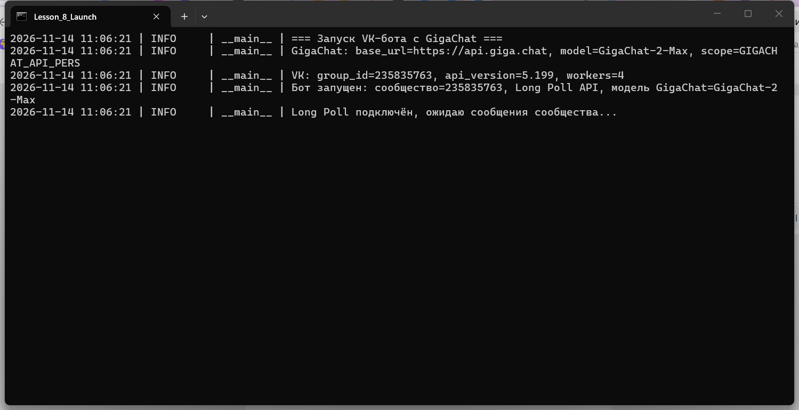

# VK GigaChat Bot — ИИ-консультант сообщества

[](https://github.com/EvgeniaMastyshka/vk-gigachat-bot/actions/workflows/ci.yml)
[](https://www.python.org/)
[](LICENSE)

Чат-бот для сообщества ВКонтакте, который консультирует клиентов по курсам
онлайн-университета **Зерокодер**. Бот слушает «Сообщения сообщества» через
**Bots Long Poll API** и отвечает с помощью **GigaChat API**, опираясь на
собственную базу знаний и удерживая контекст диалога.

Это учебный проект, доведённый до состояния рабочего сервиса: с конфигурацией
через `.env`, обработкой ошибок API, логированием, тестами, CI и инструкциями
по развёртыванию.



---

## Содержание

- [Задача](#задача)
- [Что умеет](#что-умеет)
- [Технологии](#технологии)
- [Как это работает](#как-это-работает)
- [Структура проекта](#структура-проекта)
- [Быстрый старт](#быстрый-старт)
- [Конфигурация](#конфигурация)
- [Команды бота](#команды-бота)
- [Тесты и качество кода](#тесты-и-качество-кода)
- [Развёртывание](#развёртывание)
- [Документация](#документация)
- [Ограничения](#ограничения)
- [Дорожная карта](#дорожная-карта)
- [Автор и лицензия](#автор-и-лицензия)

---

## Задача

Сообществу нужен консультант, который отвечает в личных сообщениях круглосуточно
и не выдумывает условия обучения. Готовые конструкторы ботов не давали нужного
контроля над промптом и данными, поэтому бот написан напрямую на API ВКонтакте
и GigaChat.

Что требовалось:

- отвечать в «Сообщениях сообщества» — и в личных сообщениях, и в беседах;
- держать контекст диалога, но не раздувать расход токенов;
- опираться только на проверенную базу знаний о курсах;
- переживать перезапуски Long Poll, дубли событий и ошибки внешних API;
- запускаться на обычном VPS без Docker и без входящих портов.

Подробный разбор задачи и результата — в [кейсе для портфолио](docs/case-study.md).

## Что умеет

- **Отвечает в диалогах сообщества.** Использует `peer_id` входящего сообщения,
  поэтому одинаково работает в личных сообщениях и в беседах, куда добавили бота.
- **Генерирует ответы через GigaChat.** Модель, температура и лимит токенов
  задаются в `.env`.
- **Опирается на базу знаний.** Файл `data/knowledge_base.md` подставляется
  в системный промпт вместе с правилами персоны «Алина».
- **Помнит контекст.** Хранит историю по каждому диалогу и отправляет
  в модель только последние N сообщений.
- **Обновляет токен сама.** Access token GigaChat живёт 30 минут, клиент
  продлевает его заранее и повторяет запрос при `401`.
- **Устойчива к сбоям.** Повторяет запрос при `429` и `5xx`, сокращает историю
  при переполнении контекста (`422`), переподключает Long Poll после обрыва,
  игнорирует повторно доставленные события.
- **Готовит текст под VK.** Убирает Markdown и делит длинные ответы на части
  до 4000 символов.
- **Пишет логи.** Консоль и `logs/bot.log` с ротацией; секреты в лог не попадают.
- **Проверяется автоматически.** 14 тестов и линтер в GitHub Actions.

## Технологии

| Слой | Что используется |
|---|---|
| Язык | Python 3.10+ |
| ВКонтакте | `vk_api`, Bots Long Poll API, `messages.send`, `messages.setActivity` |
| LLM | GigaChat REST API (`/v1/chat/completions`), OAuth 2.0 |
| HTTP | `requests` с отдельной сессией на поток |
| Конфигурация | `python-dotenv`, валидация в `config.py` |
| Надёжность | `ThreadPoolExecutor`, блокировки по диалогам, повторные попытки |
| Качество | `pytest`, `ruff`, GitHub Actions |
| Деплой | systemd, NSSM / Планировщик заданий Windows |

## Как это работает

```text
Пользователь пишет в «Сообщения сообщества» ВК
                │
                ▼
Bots Long Poll API (событие message_new)
                │
                ▼
bot.py: проверка дублей, peer_id, история диалога
                │
                ▼
gigachat.py: access token по Authorization Key
                │
                ▼
POST https://api.giga.chat/v1/chat/completions
                │
                ▼
Ответ модели → очистка Markdown → деление на части
                │
                ▼
messages.send(peer_id=...) → тот же диалог ВК
```

Ключевые решения и компромиссы описаны в [docs/architecture.md](docs/architecture.md).

## Структура проекта

```text
vk-gigachat-bot/
├── src/vk_gigachat_bot/        # пакет приложения
│   ├── __main__.py             # python -m vk_gigachat_bot
│   ├── bot.py                  # Long Poll, команды, отправка ответов
│   ├── config.py               # загрузка и проверка .env
│   ├── gigachat.py             # OAuth, токен, запросы к GigaChat
│   ├── prompts.py              # персона «Алина», тексты команд
│   └── text_utils.py           # очистка Markdown, разбиение под лимит VK
├── data/knowledge_base.md      # база знаний о курсах
├── certs/                      # корневые сертификаты Минцифры (публичные)
├── docs/                       # документация и скриншоты
├── scripts/                    # запуск для Windows и Linux/macOS
├── tests/                      # тесты pytest
├── .github/                    # CI и шаблоны issue / PR
├── .env.example                # шаблон настроек без секретов
├── pyproject.toml              # метаданные, pytest и ruff
├── requirements.txt            # зависимости приложения
└── README.md
```

## Быстрый старт

Нужны Python 3.10+, ключ GigaChat API и сообщество ВК, где вы администратор.

```bash
git clone https://github.com/EvgeniaMastyshka/vk-gigachat-bot.git
cd vk-gigachat-bot

python -m venv .venv
# Windows: .venv\Scripts\activate
# Linux/macOS: source .venv/bin/activate
pip install -r requirements.txt

cp .env.example .env      # Windows: Copy-Item .env.example .env
```

Заполните минимум четыре переменные в `.env`:

```dotenv
GIGACHAT_AUTH_KEY=...   # Authorization Key из GigaChat Studio
GIGACHAT_SCOPE=GIGACHAT_API_PERS
VK_TOKEN=...            # ключ доступа сообщества с правом «Сообщения сообщества»
VK_GROUP_ID=...         # числовой ID сообщества без минуса
```

Запуск:

```bash
# Windows — двойной клик по scripts\start.bat
PYTHONPATH=src python -m vk_gigachat_bot
```

В логе должно появиться:

```text
=== Запуск VK-бота с GigaChat ===
GigaChat: base_url=https://api.giga.chat, model=GigaChat-2-Max, scope=GIGACHAT_API_PERS
VK: group_id=123456789, api_version=5.199, workers=4
Long Poll подключён, ожидаю сообщения сообщества...
```

Напишите сообществу с другого аккаунта — ответ придёт в тот же диалог.

Где брать ключи и что включить в сообществе:

- [Настройка GigaChat API](docs/gigachat-setup.md);
- [Настройка сообщества ВКонтакте](docs/vk-setup.md).

## Конфигурация

Все параметры читаются из `.env`. Обязательные — `GIGACHAT_AUTH_KEY`,
`VK_TOKEN` и `VK_GROUP_ID`.

| Переменная | По умолчанию | Назначение |
|---|---|---|
| `GIGACHAT_AUTH_KEY` | — | Authorization Key из GigaChat Studio |
| `GIGACHAT_SCOPE` | `GIGACHAT_API_PERS` | версия API по типу аккаунта |
| `VK_TOKEN` | — | ключ доступа сообщества с правом `messages` |
| `VK_GROUP_ID` | — | числовой ID сообщества без минуса |
| `GIGACHAT_MODEL` | `GigaChat-2-Max` | модель генерации |
| `GIGACHAT_BASE_URL` | `https://api.giga.chat` | адрес GigaChat API |
| `GIGACHAT_OAUTH_URL` | `https://ngw.devices.sberbank.ru:9443/api/v2/oauth` | получение access token |
| `GIGACHAT_TEMPERATURE` | `0.7` | случайность ответов, 0–2 |
| `GIGACHAT_MAX_TOKENS` | `1024` | максимум токенов в ответе |
| `GIGACHAT_TIMEOUT` | `60` | таймаут HTTP-запроса, секунды |
| `GIGACHAT_VERIFY_SSL` | `true` | проверять SSL-сертификат |
| `GIGACHAT_CA_BUNDLE` | — | путь к дополнительному корневому сертификату |
| `VK_API_VERSION` | `5.199` | версия VK API |
| `BOT_WORKERS` | `4` | сколько диалогов обрабатывать параллельно |
| `MAX_HISTORY_MESSAGES` | `12` | сколько последних сообщений отправлять в модель |
| `LOG_LEVEL` | `INFO` | `DEBUG`, `INFO`, `WARNING`, `ERROR`, `CRITICAL` |

Необязательно: `KNOWLEDGE_BASE_PATH` — путь к другому файлу базы знаний.

## Команды бота

| Команда | Действие |
|---|---|
| `/start` | очистить историю и показать приветствие |
| `/help` | показать справку |
| `/reset` | очистить историю диалога |
| обычный текст | ответ GigaChat с учётом базы знаний |

История хранится в памяти процесса отдельно для каждого `peer_id`.

## Тесты и качество кода

```bash
pip install -r requirements-dev.txt
pytest
ruff check .
```

Тесты не обращаются к сети: проверяются разбор `.env`, промпт и обработка
текста. CI прогоняет их на Python 3.10, 3.11 и 3.12 при каждом push и pull request.

## Развёртывание

Бот — долгоживущий процесс: Long Poll должен работать постоянно.
Пошаговые инструкции для systemd и Windows Server — в
[docs/deployment.md](docs/deployment.md).

Входящие порты не нужны: сервер сам подключается к `api.vk.com`,
`api.giga.chat` и `ngw.devices.sberbank.ru:9443`.

## Документация

| Документ | О чём |
|---|---|
| [docs/architecture.md](docs/architecture.md) | схема работы, решения и компромиссы |
| [docs/gigachat-setup.md](docs/gigachat-setup.md) | ключи GigaChat, scope, SSL-сертификаты |
| [docs/vk-setup.md](docs/vk-setup.md) | токен сообщества, Long Poll, права |
| [docs/deployment.md](docs/deployment.md) | systemd, Windows, обновление |
| [docs/troubleshooting.md](docs/troubleshooting.md) | таблица ошибок и что проверять |
| [docs/security.md](docs/security.md) | секреты, права, реакция на утечку |
| [docs/case-study.md](docs/case-study.md) | кейс проекта для портфолио |

## Ограничения

- Обрабатываются только **текстовые** сообщения; на вложения бот просит написать текстом.
- История диалога хранится в памяти и не переживает перезапуск.
- Используется Long Poll, поэтому нужен постоянно работающий процесс.
- Бот не публикует записи на стену и не отвечает в комментариях.

## Дорожная карта

- [ ] Хранение истории в Redis или PostgreSQL.
- [ ] Приём изображений и документов с передачей в мультимодальную модель.
- [ ] Метрики и health-check для мониторинга.
- [ ] Docker-образ и пример `docker-compose.yml`.
- [ ] Ответы по расписанию и передача диалога оператору.

## Автор и лицензия

Автор: **Евгения Мастышка** — [GitHub](https://github.com/EvgeniaMastyshka).

Проект распространяется по лицензии [MIT](LICENSE).
